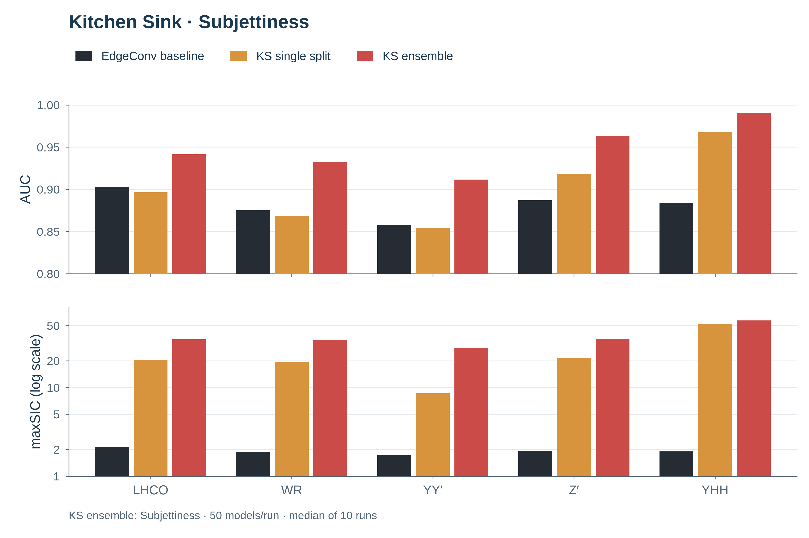
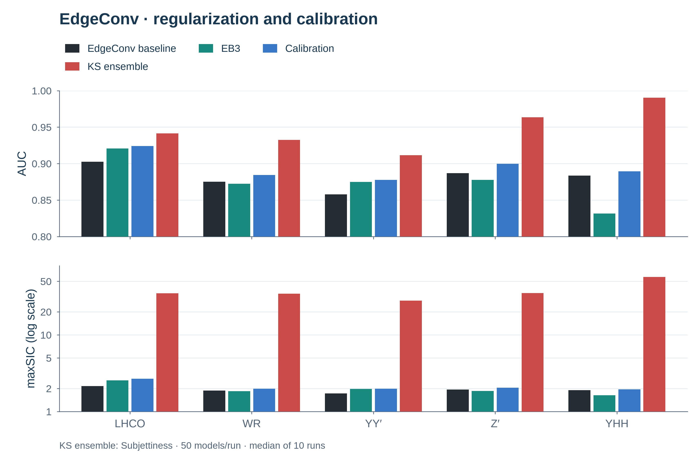
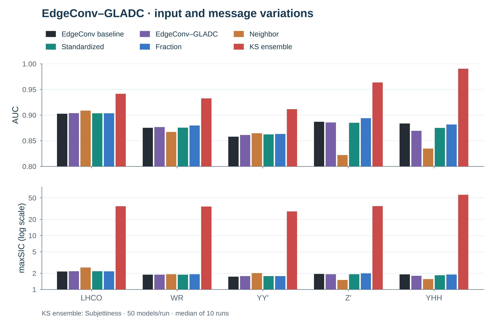
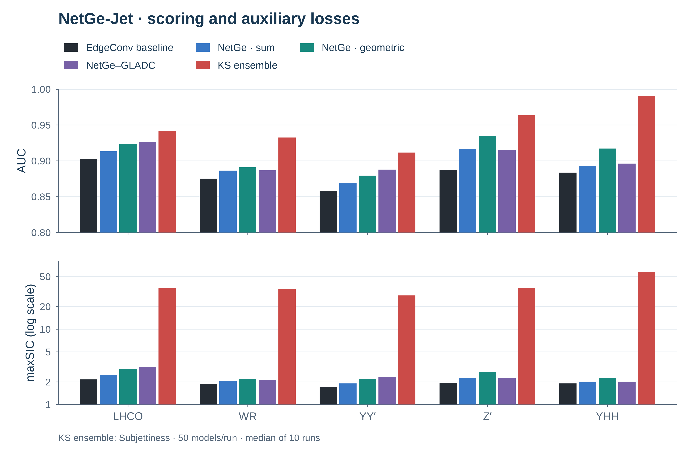
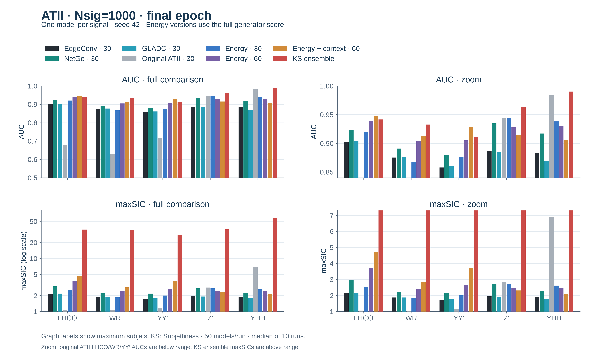

# Results

All results use `Nsig=1000`, injected before mass cuts, with separate training
for each signal. Tests contain 340,000 background and 20,000 signal events in
`3.3 < mJJ < 3.7 TeV`. See [data settings](data_pipeline.md#2-cwola-settings).

Table entries are **AUC / maxSIC**, using the paper’s background-statistics cut.

## 1. Kitchen Sink reproduction: Subjettiness

GBDTs use 56 features to classify SR (`3.3–3.7 TeV`) versus SB (`3.1–3.3`
and `3.7–3.9 TeV`), with a 50/50 training/validation split.

- **Single split:** one classifier per signal, seed **42**.
- **Ensemble:** average predictions from **50 classifiers per run**; report
  median AUC and median maxSIC over **10 runs**, following the
  [paper's ensemble protocol](https://arxiv.org/html/2604.20965v1#S2.SS2).

| Our reproduction | LHCO | WR | YY′ | Z′ | YHH |
| --- | ---: | ---: | ---: | ---: | ---: |
| Single split | 0.8964 / 20.584 | 0.8687 / 19.389 | 0.8544 / 8.567 | 0.9186 / 21.321 | 0.9673 / 52.106 |
| Ensemble | 0.9414 / 34.963 | 0.9326 / 34.452 | 0.9116 / 28.018 | 0.9634 / 35.121 | 0.9903 / 57.066 |

## 2. EdgeConv: baseline, regularization and calibration

### Default settings for graph models

- Train on SR only: 60,000 training and 60,000 validation events per signal.
- 30-subjet Unique-6 graphs; node `ln(pT)` and three physical edge features.
- Seed **42**, 50 epochs, evaluation every 5 epochs; report **epoch 50**.
- AdamW, OneCycleLR peak `0.003`, batch 256 events (512 jets), weight decay
  `0.01`, gradient clipping `1.0`.
- Objective: node MSE + physical-edge MSE. Event score: `s0 + s1`, where each
  jet error is node MSE + edge MSE.

### Methods

- **Baseline:** [EdgeConv](../src/models/edgeconv.py).
- **+ EB3:** same model, adding a penalty on latent distances between connected
  nodes, with weight `1`.
- **Calibration:** convert baseline and EB3 event scores to validation
  percentiles, then blend them using jet momentum concentration and radius.
  Fit the calibration statistics on SR validation.

### Epoch-50 results

| Signal | Baseline | + EB3 | Calibration |
| --- | ---: | ---: | ---: |
| LHCO | 0.9024 / 2.148 | 0.9206 / 2.555 | 0.9242 / 2.677 |
| WR | 0.8752 / 1.873 | 0.8723 / 1.839 | 0.8843 / 1.987 |
| YY′ | 0.8578 / 1.728 | 0.8749 / 1.967 | 0.8775 / 1.985 |
| Z′ | 0.8869 / 1.940 | 0.8777 / 1.853 | 0.8998 / 2.047 |
| YHH | 0.8836 / 1.903 | 0.8316 / 1.630 | 0.8893 / 1.945 |

EB3 improves LHCO and YY′ but hurts the other three signals. Calibration
improves both metrics over baseline on all five signals.

## 3. EdgeConv–GLADC and variations

[EdgeConv–GLADC](../src/models/gladc.py) adds node cycle, graph cycle and
contrastive losses to the EdgeConv baseline, all with weight `1`.

- **Neighbor:** add the neighbor difference `h_j - h_i` to encoder messages.
- **Standardized:** standardize node and edge features using training-set means
  and standard deviations; reconstruction errors use these standardized features.
- **Fraction:** use `ln(pT_i / sum(pT))` within each jet, then standardize node
  and edge features as above.

| Model | LHCO | WR | YY′ | Z′ | YHH |
| --- | ---: | ---: | ---: | ---: | ---: |
| Baseline | 0.9024 / 2.148 | 0.8752 / 1.873 | 0.8578 / 1.728 | 0.8869 / 1.940 | 0.8836 / 1.903 |
| EdgeConv–GLADC | 0.9038 / 2.178 | 0.8767 / 1.875 | 0.8611 / 1.763 | 0.8855 / 1.918 | 0.8692 / 1.793 |
| Neighbor | 0.9087 / 2.554 | 0.8670 / 1.910 | 0.8644 / 2.011 | 0.8221 / 1.499 | 0.8346 / 1.555 |
| Standardized | 0.9035 / 2.181 | 0.8755 / 1.872 | 0.8623 / 1.767 | 0.8851 / 1.916 | 0.8748 / 1.833 |
| Fraction | 0.9035 / 2.166 | 0.8795 / 1.909 | 0.8630 / 1.767 | 0.8939 / 1.990 | 0.8816 / 1.885 |

Fraction improves both metrics over EdgeConv–GLADC on four signals, with a small LHCO
decrease. Neighbor improves LHCO and YY′, but substantially lowers Z′ and YHH.

[What we tried and learned](edgeconv-gladc.md).

## 4. NetGe-Jet: max-message + bilinear decoder

- Standardize node and edge features using training-set means and standard deviations.
- Embed nodes with `Linear + GELU`; combine self, neighbor-difference and edge
  features, using max aggregation and a two-dimensional node latent.
- Use a symmetric linear + bilinear edge decoder.
- **Geometric score:** replace `s0 + s1` with `2 * sqrt(s0 * s1)`.
- **NetGe–GLADC:** add node cycle,
  graph cycle and contrastive losses, each with weight `1`.

The first two rows use the same checkpoints; the third is trained with the
auxiliary losses.

| Variant / event score | LHCO | WR | YY′ | Z′ | YHH |
| --- | ---: | ---: | ---: | ---: | ---: |
| Reconstruction / sum | 0.9131 / 2.465 | 0.8863 / 2.065 | 0.8685 / 1.903 | 0.9166 / 2.274 | 0.8927 / 1.966 |
| Reconstruction / geometric | 0.9239 / 2.966 | 0.8908 / 2.193 | 0.8793 / 2.175 | 0.9347 / 2.720 | 0.9170 / 2.265 |
| NetGe–GLADC / geometric | 0.9263 / 3.138 | 0.8867 / 2.109 | 0.8876 / 2.323 | 0.9151 / 2.259 | 0.8961 / 1.998 |

Geometric scoring improves both metrics on all five tests. Adding cycle and
contrastive losses helps LHCO and YY′, but lowers WR, Z′ and YHH. We retain
reconstruction-only training with geometric scoring as the main NetGe variant.

[NetGe variations and what we learned](netge.md) ·
[NetGe–GLADC: cycle and contrastive](netge-gladc.md).

## 5. SDM–ATII and energy adaptations

Same SR splits, seed 42 and epoch-50 reporting. Train one model per signal.

- **Original ATII:** GIN generator and scalar critic; node features and adjacency.
  RMSprop `0.001`, batch 128 events. Score: negative critic output.
- **Energy:** NetGe max-message/bilinear generator and AE critic; fixed Unique-6
  connections, standardized node and physical-edge features. Adam `0.0002`
  with cosine decay to `0.000002`, batch 256 events.
- **Critic context:** add mean incident-edge features to the critic's node
  embedding, adding 96 parameters. The generator stays unchanged.

Energy versions use posterior-mean node/edge discrepancy + `0.01 × KL` +
critic energy of the reconstructed graph, summed over the two jets.

### 30 subjets

| Model | LHCO | WR | YY′ | Z′ | YHH |
| --- | ---: | ---: | ---: | ---: | ---: |
| Original ATII | 0.6783 / 1.057 | 0.6277 / 1.044 | 0.7150 / 1.141 | 0.9438 / 2.832 | 0.9835 / 6.901 |
| Energy | 0.9202 / 2.525 | 0.8668 / 1.841 | 0.8758 / 2.001 | 0.9437 / 2.730 | 0.9381 / 2.617 |

### 60 subjets

| Model | LHCO | WR | YY′ | Z′ | YHH |
| --- | ---: | ---: | ---: | ---: | ---: |
| Energy | 0.9388 / 3.732 | 0.9043 / 2.423 | 0.9050 / 2.634 | 0.9277 / 2.467 | 0.9301 / 2.455 |
| Energy + critic context | 0.9474 / 4.715 | 0.9133 / 2.841 | 0.9286 / 3.739 | 0.9147 / 2.310 | 0.9060 / 2.105 |

Energy 60 exceeds 0.90 AUC on all five signals. Critic context further improves
LHCO, WR and YY′, but lowers Z′ and YHH. At 30 subjets, Energy improves over
NetGe's geometric score on Z′ and YHH, but not on LHCO, WR or YY′.

[ATII experiments, BB1 results and commands](atii.md).
